<p align="center">
  
</p>

<p align="center">
  <a href="https://weden.gitbook.io/odoo-developer-handbook"></a>
  
  
  
  <a href="../LICENSE"></a>
</p>

<p align="center">
  <b>A self-contained handbook for building Odoo modules.</b><br>
  It starts from the language fundamentals and ends with complete modules that change standard views,<br>
  extend standard workflows, and run backend logic safely in production.
</p>

<p align="center">
  <a href="https://weden.gitbook.io/odoo-developer-handbook">Read online</a> &nbsp;|&nbsp;
  <a href="#contents">Contents</a> &nbsp;|&nbsp;
  <a href="#where-to-start">Where to start</a> &nbsp;|&nbsp;
  <a href="#how-the-book-is-kept-honest">Accuracy</a> &nbsp;|&nbsp;
  <a href="#contributing">Contributing</a>
</p>

---

## Why this book exists

Imagine the assistants are offline, the forums are unreachable and the official documentation is as fragmented as ever, yet the deadline is not moving. This book is the thing you would want open on the second monitor: the Python you actually need, the SQL you actually run, the ORM and view machinery explained with the reason behind every rule, and the production habits (impact tracing, savepoints, advisory locks, dry runs) that keep a database safe.

It is written as one developer talking to another. No marketing tone, no filler. Every chapter has a pitfalls section, and the dangerous commands always come after their read-only counterparts.

<p align="center">
  
</p>

## Contents

| # | Part | What it covers |
| ---: | --- | --- |
| 00 | [Start here](../00-start) | How to read the book, conventions, the Odoo mental model |
| 01 | [Python for Odoo](../01-python) | The language, only the parts Odoo code depends on |
| 02 | [PostgreSQL for Odoo](../02-postgresql) | SQL, joins, indexes, transactions, locks, the Odoo schema |
| 03 | [Web basics](../03-web-basics) | HTML, CSS, JavaScript, HTTP and JSON, XML for Odoo |
| 04 | [Odoo architecture](../04-architecture) | Installation, module anatomy, the registry, the request lifecycle, Odoo.sh |
| 05 | [Shell and debugging](../05-shell-and-debugging) | `odoo shell`, scripts, logging, debuggers, profiling, an error catalogue |
| 06 | [The ORM](../06-orm) | Fields, recordsets, search, inheritance, overrides, performance |
| 07 | [Security](../07-security) | Access rights, record rules, multi-company, secure coding |
| 08 | [Data and views](../08-data-and-views) | XML data, views, XPath inheritance, wizards, reports, cron |
| 09 | [Frontend and JavaScript](../09-frontend-js) | OWL 2 and OWL 3, assets, patching, widgets, portal, tours, hoot tests |
| 10 | [Backend logic](../10-backend-logic) | Controllers, state machines, concurrency, APIs, synchronisation |
| 11 | [Testing and quality](../11-testing-and-quality) | Tests, standards, git workflow |
| 12 | [Migration and versions](../12-migration-and-versions) | What changed between versions and how to upgrade |
| 13 | [Blueprints](../13-blueprints) | Complete modules built step by step |
| 14 | [Reference](../14-reference) | Cheat sheets and catalogues |

## Where to start

| You are... | Begin with |
| --- | --- |
| New to programming | [Python for Odoo](../01-python), in order |
| Comfortable in Python, new to Odoo | [Odoo architecture](../04-architecture), then [The ORM](../06-orm) |
| Debugging something right now | [Shell and debugging](../05-shell-and-debugging) and the common errors catalogue |
| Building a frontend | [Frontend overview](../09-frontend-js/frontend-overview.md) |
| Upgrading a module | [Migration and versions](../12-migration-and-versions) |
| Writing a security model | [The security model](../07-security/security-model.md) |

## How the book is kept honest

- **Checked against the real source.** Names, signatures and behaviour are verified against the Odoo 18 source and, since the source is available, Odoo 20. Version differences sit in marked notes instead of being hidden.
- **Odoo 20 is a different frontend.** It ships OWL 3: `static props` becomes `useProps`, `useState` becomes `proxy`, templates use `this.`. [One chapter](../09-frontend-js/owl3-and-odoo-20.md) covers the port.
- **One teaching module.** Examples use a neutral `library` module (`library.book`, `library.loan`). No real client, company or credential appears anywhere.
- **Hedged where unverified.** A statement that could not be confirmed says so, rather than being stated as fact.
- **Run what you can.** Scripts and queries that change data are always preceded by their read-only counterpart.

See [`STYLE.md`](../STYLE.md) for the authoring rules every chapter follows.

## Status

The book is large and the depth is uneven while it is being expanded. The Python, PostgreSQL, web basics and frontend parts are the most detailed; the rest are being brought to the same depth part by part, with the source checked each time. If a page feels thin, it is on the list.

## Using it offline

```bash
git clone https://github.com/rxxddy/odoo.start.point.git
cd odoo.start.point
# every chapter is plain Markdown; SUMMARY.md is the table of contents
```

Any Markdown viewer works. The site is built by [GitBook](https://www.gitbook.com/) from this repository (`SUMMARY.md` and `.gitbook.yaml`), and the `` and `<details>` blocks are GitBook syntax that degrade to readable text elsewhere.

## Contributing

Corrections are the most useful contribution: a wrong name, a signature that changed, a command that failed on your version. Open an issue with the page, the version you run, and what you saw. Pull requests that follow [`STYLE.md`](../STYLE.md) are welcome. Never include client data, domains, credentials or identifiers in examples.

## License

Apache License 2.0, see [`LICENSE`](../LICENSE).
